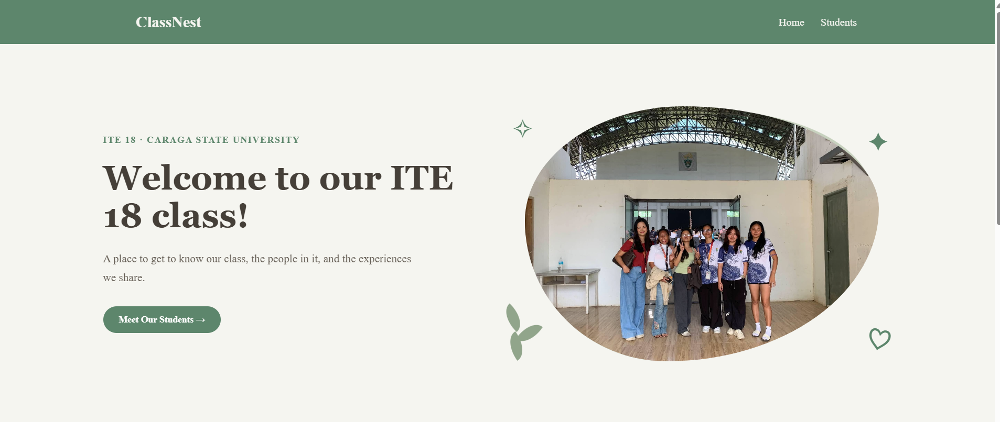
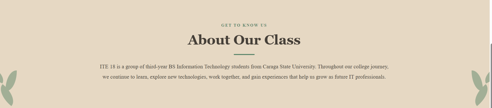
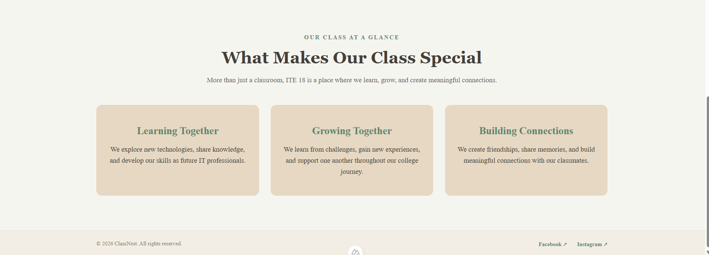
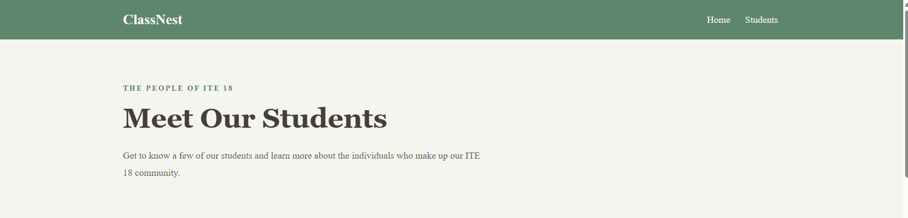
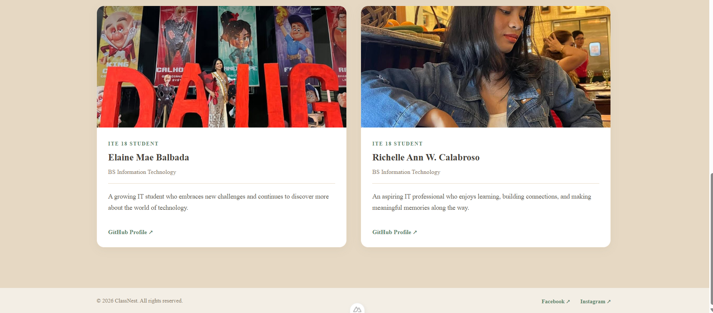
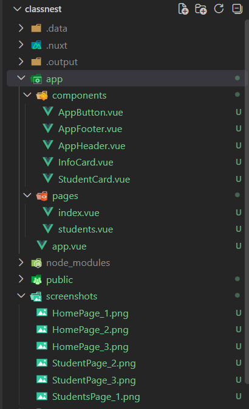
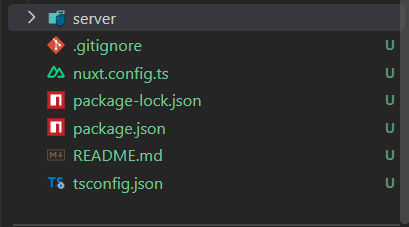

# ClassNest – ITE 18 Reusable Components

A class information website developed using **Nuxt 4** for the ITE 18 – Applications Development and Emerging Technologies activity on Reusable Components.

ClassNest is a simple website that introduces our ITE 18 class and features selected student profiles. It provides visitors with basic information about the class and allows them to get to know some of its students.

This project demonstrates the use of reusable Vue components and props to create an organized, consistent, and easy-to-maintain website.

**Course:** ITE 18  
**Year Level:** 3rd Year – BSIT  
**Section:** AIEM1  
**School:** Caraga State University

---

## Project Screenshots

The following screenshots show the different pages and sections of the ClassNest website.

### 1. Home Page

The Home page welcomes visitors and introduces the ITE 18 class. It includes an overview of the class and highlights some of the things that make our class special.








### 2. Students Page

The Students page introduces selected members of ITE 18 through individual student profile cards. Each card displays a student's picture, name, course, short description, and GitHub profile link.







---

## Project Folder Structure

The project follows the Nuxt 4 directory structure, with reusable Vue components organized inside the `app/components/` directory.

The screenshot below shows the folder structure of the ClassNest project.



---

## Technologies Used

- **Nuxt 4** – Framework used to build the website.
- **Vue 3** – Used to create reusable components and build the website interface.
- **JavaScript** – Used for component logic and passing data through props.
- **HTML** – Used to structure the website content.
- **CSS** – Used to style the pages and components.
- **npm** – Used to install dependencies and run project commands.

---

## Source Code

The complete source code of this project is available through the GitHub repository:

**GitHub Repository:**  
[Calabroso_ITE-18--Act-2--Reusable-Components](https://github.com/calabrosorichelleann-workac/Calabroso_ITE-18--Act-2--Reusable-Components)

---

## Setup

Before running the project, make sure you have installed:

- [Node.js](https://nodejs.org/)
- npm (included with Node.js)

### 1. Clone the Repository

Open a terminal and run:

```bash
git clone https://github.com/calabrosorichelleann-workac/Calabroso_ITE-18--Act-2--Reusable-Components.git
```

### 2. Open the Project Folder

```bash
cd Calabroso_ITE-18--Act-2--Reusable-Components
```

### 3. Install Dependencies

```bash
npm install
```

---

## Development Server

Start the development server using:

```bash
npm run dev
```

Once the server starts, open your browser and visit:

```text
http://localhost:3000/
```

To stop the development server, press `Ctrl + C` in the terminal.

---

## Production Build

To build the application for production, run:

```bash
npm run build
```

To preview the production build locally, run:

```bash
npm run preview
```

---

## Author

**Richelle Ann W. Calabroso**  
Third-Year BS Information Technology Student  
Caraga State University

**Activity:** Activity 2 – Build Your Own Reusable Components  
**Project:** ClassNest – ITE 18 Reusable Components